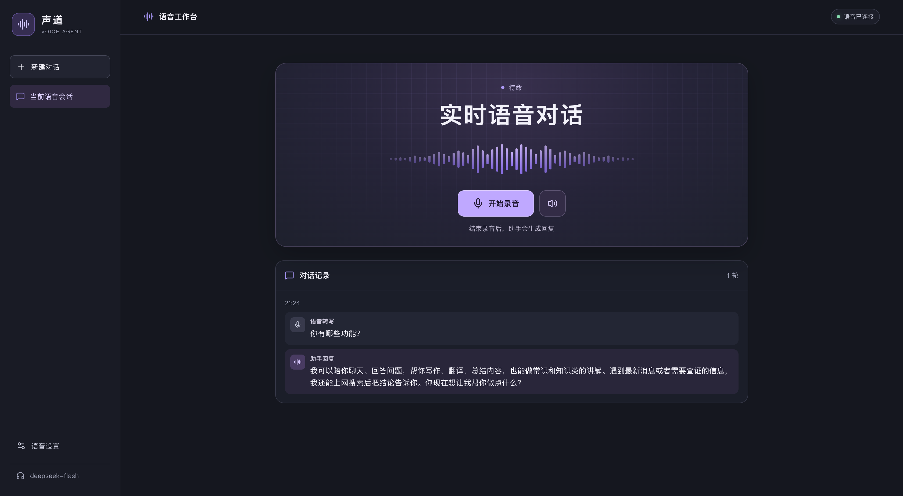

# 声道 · 实时语音 Agent

点击开始录音，页面边录边显示转写。结束录音后，助手流式显示回复，可同步播报。遇到最新信息或用户明确要求搜索时，助手会调用智谱网络搜索，并在回复下方显示来源链接。



## 本地启动

需要 Node.js 22.13+、Python 3.11+ 和 uv。从仓库根目录启动前后端。

```bash
./scripts/dev.sh
```

首次启动会安装依赖，按 `Ctrl+C` 关闭两个服务。

打开前端 [localhost:8007](http://localhost:8007)。后端默认监听 `127.0.0.1:8008`。

在左侧 **语音设置** 填写阿里云百炼、DeepSeek 和智谱的 API Key，保存后即可开始录音。模型和搜索引擎可自行填写，留空时使用下表中的默认值。百炼接入地域应与 API Key 匹配。

| 配置项 | 默认值 |
| --- | --- |
| 语音识别模型 | `fun-asr-realtime` |
| 对话模型 | `deepseek-flash` |
| 语音合成模型 | `qwen3-tts-flash-realtime` |
| 合成音色 | `Cherry` |
| 搜索引擎 | `search_std` |
| 百炼接入地域 | 华北 2（北京） |

API Key 和模型配置以明文保存在当前站点的 `localStorage`，可在语音设置中清除。后端在 WebSocket 连接内使用配置，修改后下次录音将建立新连接。

| 环境变量 | 用途 | 默认值 |
| --- | --- | --- |
| `VOICE_WEB_PORT` | Vite 开发服务器监听端口，端口占用时启动报错 | `8007` |
| `VOICE_PORT` | FastAPI 监听端口 | `8008` |
| `VOICE_HOST` | FastAPI 监听地址 | `127.0.0.1` |
| `VOICE_MAX_SESSIONS` | 每个进程的 WebSocket 会话上限 | `24` |
| `VOICE_ORIGIN` | 允许发起 WebSocket 的页面来源 | 本机回环来源 |
| `VOICE_ACCESS_TOKEN` | 在页面语音设置中输入的服务访问令牌 | 生产模式及非回环监听必填，至少 24 字符 |

## 音频与搜索链路

1. React 使用 Web Audio API 和 AudioWorklet 将麦克风输入转换为 16 kHz 单声道 PCM，每 100 ms 通过 WebSocket 向 FastAPI 发送一帧。
2. FastAPI 把音频送入 Fun ASR Realtime。录音期间回传中间转写，结束后把整轮最终转写交给 Agent。
3. LangGraph 编排 LangChain 模型和搜索节点。DeepSeek Flash 根据问题决定是否调用智谱 Web Search。搜索结果供模型组织回复，来源链接随回复单独显示。
4. 开启播报时，千问 `qwen3-tts-flash-realtime` 持续接收文字增量并返回 24 kHz PCM，浏览器边接收边播放。打断或断线会取消本轮的上游任务。

单轮录音最多 60 秒，每个连接在内存保留最近 6 轮完整问答。新建对话或断开连接会清空服务端上下文。应用日志记录轮次耗时和失败类型。

接口文档可查阅 [Fun ASR](https://help.aliyun.com/en/model-studio/fun-asr-realtime-websocket-api)、[千问实时 TTS](https://help.aliyun.com/en/model-studio/interactive-process-of-qwen-tts-realtime-synthesis)、[DeepSeek Flash](https://api-docs.deepseek.com/quick_start/pricing/) 和 [智谱 Web Search](https://docs.bigmodel.cn/cn/guide/tools/web-search)。

## 目录结构

| 路径 | 职责 |
| --- | --- |
| `apps/voice-agent-api/voice_agent/main.py` | FastAPI 应用组装、依赖初始化和静态文件服务 |
| `apps/voice-agent-api/voice_agent/routes.py` | HTTP 路由、WebSocket 入口和鉴权 |
| `apps/voice-agent-api/voice_agent/voice/` | 会话生命周期、轮次编排和服务端协议 |
| `apps/voice-agent-api/voice_agent/agent/` | LangGraph 状态图、DeepSeek 模型接入和智谱搜索工具 |
| `apps/voice-agent-api/voice_agent/speech/` | 百炼连接、Fun ASR 识别和千问 TTS 合成 |
| `apps/voice-web/src/routers.ts` | React Router 路由配置，首页对应语音工作台 |
| `apps/voice-web/src/pages/` | 页面布局、配置读取和会话操作入口 |
| `apps/voice-web/src/components/` | 录音、对话记录、会话侧栏和语音设置组件 |
| `apps/voice-web/src/services/` | 会话状态、WebSocket、配置存储和音频采集与播放 |
| `apps/voice-web/src/types/`、`apps/voice-web/src/constants/` | 会话与协议类型、音频参数 |
| `apps/voice-web/src/styles/` | 全局样式 |
| `apps/voice-web/public/pcm-capture.js` | 浏览器加载的 AudioWorklet 处理器 |

## 前端代码格式化

```bash
npm --prefix apps/voice-web run format
npm --prefix apps/voice-web run format:check
```

## 构建与部署

```bash
npm --prefix apps/voice-web run build
npm --prefix apps/voice-web test
uv run --locked --project apps/voice-agent-api pytest apps/voice-agent-api/tests
```

配置 `VOICE_ACCESS_TOKEN` 和 `VOICE_ORIGIN` 后，启动生产服务。

```bash
VOICE_ENV=production uv run --locked --no-dev --project apps/voice-agent-api python -m voice_agent
```

FastAPI 同源服务前端和 API。HTTPS 反向代理须把 `/api/voice/ws` 转发为 WebSocket，健康检查路径为 `GET /api/health`。浏览器通过 WebSocket 首帧向后端发送应用访问令牌和服务配置，后端负责调用云服务。

测试覆盖 PCM 分包、FastAPI WebSocket 会话、LangGraph 搜索调用、Fun ASR 和千问实时 TTS 的模拟协议。
